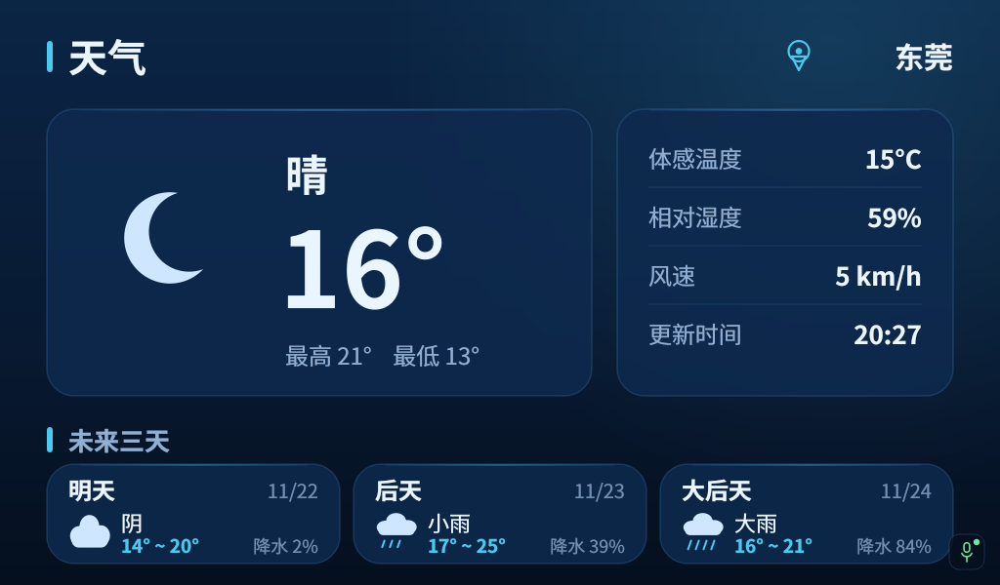
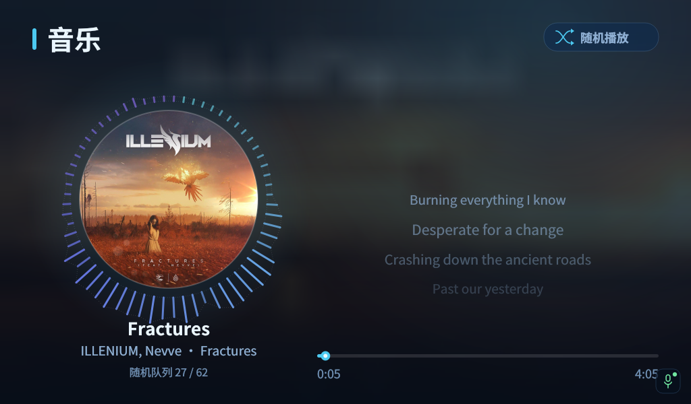
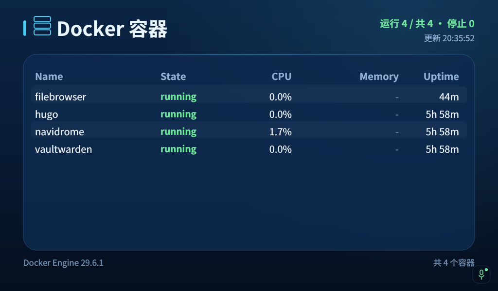
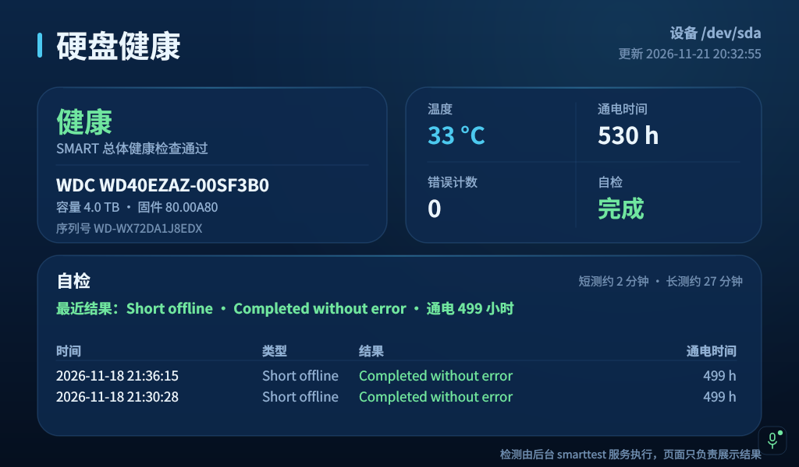
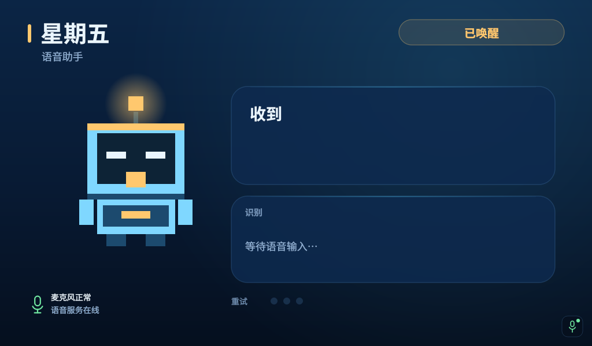

# Minihost 演示效果

以下为 Minihost 在 HDMI 1024×600 屏幕（Qt6）上的实际运行界面，各页面支持语音或 MQTT 切换。

## 壁纸

全屏自定义壁纸页面，右下角常驻语音助手入口。

## 天气

显示当前天气、体感温度、湿度、风速及未来三天预报，数据自动更新。

## 音乐

展示专辑封面、歌词、播放进度与随机播放控制。

## Docker 容器

实时展示各容器运行状态、CPU 占用与运行时长。

## 硬盘健康

基于 SMART 显示硬盘健康状态、温度、通电时间、错误计数与自检结果。

## 语音助手

本地语音识别（vosk），唤醒后可通过语音切换屏幕页面。

## 图片幻灯片

全屏展示图片，支持幻灯片轮播。

---

返回 [README](README.md)
